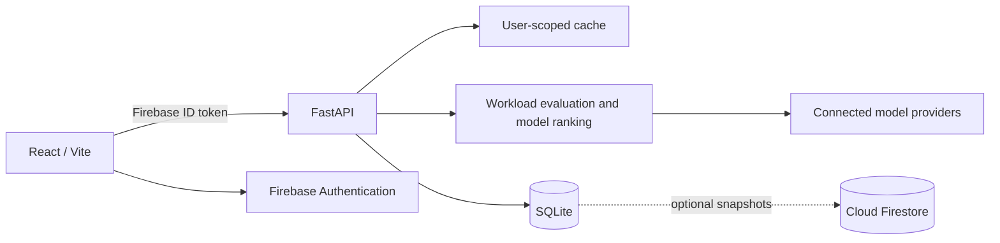

# OptiRoute · AI Router

[](https://github.com/sharma23Mukul/AI-Router/actions/workflows/ci.yml)

OptiRoute routes signed-in users' prompts across their connected AI models in **light, mid, and heavy** tiers. A React playground and dashboard sit on a FastAPI backend with user-scoped caching and persistent chat history.

## Features

- Firebase email/password and Google sign-in.
- Provider connections with API keys encrypted using Fernet.
- Workload-based tier selection, model ranking, fallback, and heavier-answer retries.
- Background completion jobs with progress polling and cancellation.
- Exact and semantic caching scoped to each user, with explicit answer selection.
- Conversation history, Markdown and math rendering, and request charts.
- SQLite storage with optional Firestore snapshots for a single-instance demo.

## Architecture



```text
AI-Router/
├── .github/workflows/     # Frontend and backend CI
├── backend/
│   ├── optiroute/         # API, auth, connections, storage, provider proxy
│   │   └── engine/        # Routing, ranking, caching, context processing
│   ├── scripts/          # Embedding-model preloading
│   ├── tests/            # Backend regression tests
│   ├── config.yaml       # Routing defaults and example tiers
│   └── requirements*.txt # Runtime and development dependencies
├── frontend/
│   ├── public/           # Static assets
│   └── src/              # Pages, components, auth utilities, styles
└── docs/                 # Architecture and deployment guides
```

## Local development

Use **Node.js 24.12.x** (`frontend/.node-version`) and **Python 3.12** (`backend/.python-version`). Firebase dependencies require Node 24.12 or newer. You also need a Firebase project with Email/Password and/or Google authentication enabled, and credentials for a supported model provider.

### Backend

From the repository root:

```sh
cd backend
python -m venv .venv
```

Activate with `.venv\Scripts\Activate.ps1` in PowerShell or `source .venv/bin/activate` on macOS/Linux. Then:

```sh
python -m pip install -r requirements-dev.txt
python -c "from cryptography.fernet import Fernet; print(Fernet.generate_key().decode())"
```

Copy `backend/.env.example` to `backend/.env`. Set `FIREBASE_PROJECT_ID` and paste the generated key into `WORKFLOW_ENCRYPTION_KEY`. Keep this key stable: existing encrypted provider credentials depend on it. Leave Firestore persistence disabled for ordinary local development.

```sh
python -m uvicorn optiroute.main:app --host 127.0.0.1 --port 8000 --reload
```

The API creates `backend/data/optiroute.db`. Health: <http://127.0.0.1:8000/health>. Interactive API reference: <http://127.0.0.1:8000/docs>.

### Frontend

In another terminal:

```sh
cd frontend
npm ci
```

Copy `frontend/.env.example` to `frontend/.env`. Fill in the four `VITE_FIREBASE_*` values from your Firebase web app settings. The example API URL points to the local backend. Add your development hostname to Firebase Authentication's authorized domains.

```sh
npm run dev
```

Open the URL printed by Vite (usually <http://localhost:5173>). Sign in, add models and provider keys on **Routing Policies**, then send a prompt in the **Playground**. Example models in `config.yaml` do not replace user connections. The first semantic-cache operation may download embedding weights; preload them with `python scripts/preload_embeddings.py` from `backend/` if needed.

## Checks

```sh
# backend/ with the virtual environment activated
python -m pytest

# frontend/
npm run lint
npm run build
```

See [CONTRIBUTING.md](CONTRIBUTING.md) for test conventions and offline versus live checks.

Known lint, bundle-size, and dependency-audit findings are recorded in [validation notes](docs/quality.md).

## Deployment and limitations

Follow the [deployment guide](docs/deployment.md) for backend and static frontend configuration. Read the [architecture notes](docs/architecture.md) for request flow and persistence details.

This is a single-instance application. SQLite and optional Firestore snapshots are not a multi-writer database architecture, and in-memory jobs do not survive restarts. Example pricing in `config.yaml` is simulated, not a billing guarantee. Production scaling needs shared durable storage, a durable job queue, and operational testing.

Environment files, service-account credentials, databases, model weights, dependencies, and build output are excluded from Git. See [SECURITY.md](SECURITY.md) for credential handling.
